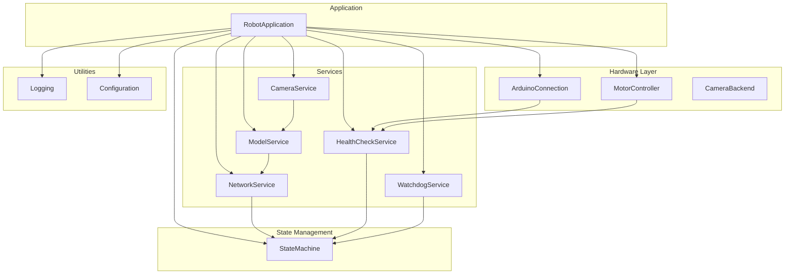

# System Design Overview (High‑Level Blueprint)

---

## 📄 Overview
The **Pest Detection Robot** is built as a modular, event‑driven application that cleanly separates concerns across **hardware**, **state management**, **services**, and **utilities**. Each layer communicates through well‑defined interfaces, enabling easy testing, replacement, and future expansion.

---

## 🧩 Core Components
| Layer | Module(s) | Responsibilities | Key Classes |
|------|-----------|------------------|--------------|
| **Hardware** | `hardware/` | Direct interaction with physical devices (Arduino, motors, camera). | `ArduinoConnection`, `MotorController`, `CameraBackend` |
| **State Management** | `states/` | Central state machine governing robot lifecycle. | `StateMachine`, `RobotState` |
| **Services** | `services/` | Runtime services that operate on top of hardware & state. | `NetworkService`, `CameraService`, `ModelService`, `HealthCheckService`, `WatchdogService`, `WiFiManager`, `LifecycleManager` |
| **Application Entry** | `app.py` | Orchestrates startup, main loop, and graceful shutdown. | `RobotApplication` |
| **Utilities** | `utils/` | Cross‑cutting concerns (logging, configuration helpers). | `setup_logging`, `get_logger` |
| **Configuration** | `configs.py` | Single source of truth for all tunable parameters. | — |

---

## 🔄 Interaction Diagram


---

## 🚀 Startup Sequence (Flow Chart)
```mermaid
graph TD
    Start[Start] --> Boot[BOOTING]
    Boot --> Arduino[Arduino.connect()]
    Arduino --> Motors[MotorController.initialize()]
    Motors --> HWReady[Hardware Ready]
    HWReady --> Checks[HealthCheckService.run_all()]
    Checks -->|All OK| Ready[READY]
    Checks -->|Any FAIL| Error[ERROR]
    Ready --> MainLoop[Main Operating Loop]
    Error --> Shutdown[SHUTDOWN]
```

---

## 📡 Data Flow
1. **Configuration Load** – `configs.py` reads environment variables and builds a global config object.
2. **Hardware Init** – `RobotApplication.__init__` creates `ArduinoConnection` and `MotorController`.
3. **Service Startup** – `NetworkService`, `CameraService`, `ModelService` are instantiated and linked via callbacks.
4. **Health Checks** – `HealthCheckService` validates Arduino, motors, camera, and AI model.
5. **State Transition** – On success, the `StateMachine` moves to `READY`; otherwise, it goes to `ERROR`.
6. **Main Loop** – Handles incoming commands, detection events, watchdog timers, and graceful shutdown.

---

## 🛡️ Error‑Handling Strategy
- **Retry logic** (configurable attempts & delay) for serial, network, and model loading.
- **Health checks** short‑circuit the startup if critical components fail.
- **State machine** forces transitions to `ERROR` on unrecoverable exceptions.
- **Watchdog service** monitors liveness of critical threads and resets them when needed.

---

## 🧪 Testing Approach
Each layer is independently unit‑testable:
- Mock `ArduinoConnection` for motor/command tests.
- Replace `NetworkService` with a fake websocket server.
- Inject a stub `CameraBackend` to feed deterministic frames.
- Verify `StateMachine` transition rules with table‑driven tests.
- Validate `HealthCheckService` reports correct statuses.

---

## 📂 File Map (Clickable Links)
- **Entry point**: [app.py](file:///f:/Coding%20WorkSpace/Python/pest-detection-model-test/app.py)
- **Configuration**: [configs.py](file:///f:/Coding%20WorkSpace/Python/pest-detection-model-test/configs.py)
- **Network Service**: [services/network_service.py](file:///f:/Coding%20WorkSpace/Python/pest-detection-model-test/services/network_service.py)
- **State Machine**: [states/state_machine.py](file:///f:/Coding%20WorkSpace/Python/pest-detection-model-test/states/state_machine.py)
- **Hardware Arduino**: [hardware/arduino.py](file:///f:/Coding%20WorkSpace/Python/pest-detection-model-test/hardware/arduino.py)
- **Motor Controller**: [hardware/motors.py](file:///f:/Coding%20WorkSpace/Python/pest-detection-model-test/hardware/motors.py)
- **Camera Service**: [services/camera_service.py](file:///f:/Coding%20WorkSpace/Python/pest-detection-model-test/services/camera_service.py)
- **Model Service**: [services/model_service.py](file:///f:/Coding%20WorkSpace/Python/pest-detection-model-test/services/model_service.py)
- **Health Service**: [services/health_service.py](file:///f:/Coding%20WorkSpace/Python/pest-detection-model-test/services/health_service.py)

---

## 🎨 Design Principles Applied
1. **Single Responsibility** – Every module does one thing.
2. **Dependency Injection** – Services receive hardware components via constructor arguments.
3. **Fail‑Fast** – Errors are logged and cause immediate state transitions.
4. **Type‑Safety** – Full type hints throughout the codebase.
5. **Extensibility** – Adding a new service only requires registering callbacks with the `LifecycleManager`.
6. **Observability** – Structured logging and heartbeat telemetry keep the system transparent.

---

*Generated by Antigravity – a powerful agentic AI coding assistant.*
